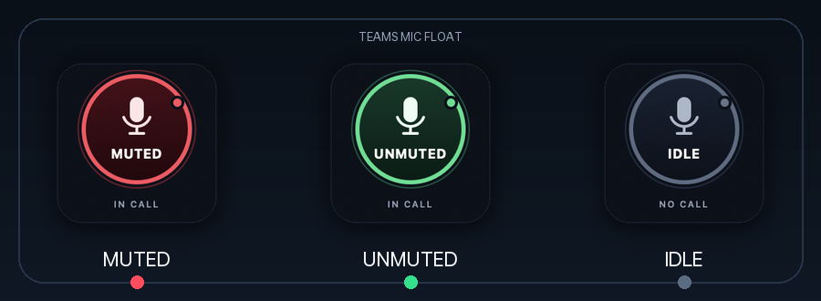

# Teams Mic Float (native macOS POC)

A lightweight, always-on-top microphone button for Microsoft Teams, written in
Swift/AppKit with no runtime dependencies. It uses the macOS Accessibility API
to read and press Teams' own microphone button, so mute changes from either
side stay in sync.



## Why Accessibility?

Microsoft retired the local Teams third-party app API on **June 30, 2026**
([MC1266901](https://msmessagecenter.com/MC1266901)). The **Third-party app
API** setting is gone from current Teams builds, and port `8124` is no longer
open.

MuteMe’s current Teams integration (v0.27.2+) uses macOS **Accessibility UI
automation** instead of the retired API. This POC uses the same approach.

Verified against the live Teams client:

- Meeting window: `Meeting compact view | …`, AX subrole `AXSystemDialog`.
- Microphone control: `AXDOMIdentifier = "microphone-button"`.
- Muted state: button title/description is **“Unmute mic”**.
- Unmuted state: button title/description is **“Mute mic”**.
- Both states expose the `AXPress` action.

## Requirements

- macOS 13 or later.
- Microsoft Teams desktop running on the same Mac.
- **Accessibility** permission for Teams Mic Float. On macOS 27 this lives under
  **System Settings → Privacy & Security → Device Control and Data Access**
  (Apple renamed the old Accessibility app list). On older macOS it is
  **Privacy & Security → Accessibility**.
- The Teams meeting window must be visible (including the compact meeting
  view). Restore it from the Dock if status shows `SYNC`.

## Build and run

```bash
cd teams-mic-float
./scripts/build_app.sh
open dist/TeamsMicFloat.app
```

Convenience launcher for later:

```bash
./scripts/run.sh
```

The app is an `LSUIElement` agent: it has no Dock icon. Use the floating button
or the menu-bar mic icon for actions and Quit.

On first launch, if the button shows amber **ACCESS**, use the menu-bar mic icon
→ **Accessibility Settings…** (or the system prompt that opens automatically),
enable **TeamsMicFloat.app** under **Device Control and Data Access**, and return
to the app. It connects automatically; no restart is required.

## Usage

- **Menu Bar Item ("Mac Taskbar")**: Look for the microphone icon in your Mac's top menu bar. It provides real-time color feedback (green = unmuted, red = muted, grey = idle/no call). Clicking it lets you toggle mute, refresh Teams detection, monitor Arduino status, or quit.
- **Floating Button Visibility**: Under the menu-bar mic icon → **Floating Button**, choose your preferred mode:
  - **Hide (Menu Bar Only)**: Completely hides the on-screen circle button, running unobtrusively in your Mac menu bar.
  - **Show During Calls Only**: Automatically shows the floating button only while an active Teams meeting is underway, and hides it when the call ends.
  - **Show Always**: Keeps the circular floating button on-screen across spaces.
- **Hardware button**: Press the button on the attached Arduino (or external button on Pin 2) to toggle the microphone via USB serial.
- **Drag** the floating button to reposition it when visible.
- **Right-click** the floating button for the context menu.
- Mute or unmute from Teams’ native UI or its `Shift+Cmd+M` shortcut; the
  floating button and menu bar icon follow within roughly 150 ms.

## Activate in future

- Double-click `dist/TeamsMicFloat.app` in Finder, or run:

  ```bash
  open "/Users/merajchhaya/Documents/GitHub/teams-mic-float/dist/TeamsMicFloat.app"
  ```

- There is no Dock icon. Look for the floating mic button and the mic icon in
  the menu bar.
- To start it automatically at login: **System Settings → General → Login
  Items & Extensions → +**, then select `dist/TeamsMicFloat.app`.
- The app is already signed with a stable local identity, so rebuilding with
  `./scripts/build_app.sh` keeps the macOS permission across builds. Do not
  delete `signing/` or re-sign the app ad-hoc.

## States

| Visual | Meaning |
|---|---|
| Red, `MUTED`, `IN CALL` | In a call; Teams microphone muted |
| Green, `UNMUTED`, `IN CALL` | In a call; microphone live |
| Grey, `IDLE`, `NO CALL` | Teams running, no active call |
| Dark grey, `OFFLINE`, `NO TEAMS` | Teams not running |
| Amber, `LINKING`, `CONNECTING` | Connecting to Teams’ accessibility tree |
| Amber, `ACCESS`, `PERMISSION` | Accessibility permission not granted |
| Grey, `SYNC`, `IN CALL` | Call detected; restore the meeting window |

## How it works

`TeamsAccessibilityController` runs a low-overhead scan every 150 ms:

1. Confirms macOS Accessibility trust.
2. Finds Microsoft Teams by bundle identifier.
3. Enables the WebView accessibility tree with `AXEnhancedUserInterface`.
4. Locates a meeting window and searches for the element with
   `AXDOMIdentifier == "microphone-button"`.
5. Infers mute state from the button’s title/description.
6. Sends `AXPress` when the floating button is clicked.
7. Re-reads the button after the press and on every scan, so native Teams
   changes flow back to the UI.

No Screen Recording permission, network connection, API token, or driver is
used.

## Project layout

```text
Sources/TeamsMicFloat/
  main.swift                        Entry point and CLI parsing
  AppDelegate.swift                 Menu bar, menus, lifecycle
  ArduinoSerialController.swift     Native USB serial listener & Arduino bridge
  FloatingPanelController.swift     Always-on-top non-activating NSPanel
  StatusView.swift                  Custom button drawing, click/drag, AXPress
  TeamsAccessibilityController.swift  Live Teams AX controller
  TeamsProtocol.swift               State models, visual mapping, legacy parser
  TeamsClient.swift                 Legacy WebSocket API client (not used by app)
  ConfigStore.swift                 Window-position persistence
  ToastController.swift             Permission and status notifications
  AppOptions.swift                  CLI options
arduino/
  teams_mic_button/
    teams_mic_button.ino            Arduino Uno firmware for button & LED
arduino-serial.py                   Python helper for testing serial without deps
Tests/TestHarness.swift             Dependency-free native test harness
tools/mock_teams_server.py          Mock server for the legacy API tests
scripts/build_app.sh                Builds dist/TeamsMicFloat.app
scripts/run.sh                      Launches the built app
scripts/run_tests.sh                Builds and runs all native checks
scripts/setup_signing.sh            Recreates the stable local signing identity
signing/                            Local signing certificate/keychain (gitignored)
```

## Arduino hardware integration

Teams Mic Float includes a native USB serial controller (`ArduinoSerialController.swift`) that connects automatically to an attached Arduino (e.g. `/dev/cu.usbmodem*`) at 115200 baud with no external dependencies or daemons.

- **Mute Toggle**: Pressing the button on the Arduino sends `TOGGLE`, which triggers `AXPress` to mute or unmute Teams.
- **State Feedback**: When the mute state changes, the Mac sends `MUTED`, `UNMUTED`, or `OFF` to the Arduino to drive the built-in LED and MAX7219 matrix display.
- **Status in Menu**: The menu bar icon displays live status: `Arduino: Connected (cu.usbmodem11301)`.

### Wiring & Pinout

#### MAX7219 8x8 LED Matrix Display
| MAX7219 Pin | Wire Color | Arduino Uno Pin | Description |
|---|---|---|---|
| **VCC** | Red | **5V** | Power |
| **GND** | Brown | **GND** | Ground |
| **DIN** | Green | **Pin 8** | SPI Data In |
| **CS / LOAD** | Yellow | **Pin 9** | Chip Select |
| **CLK** | Orange | **Pin 10** | Clock |

#### Push Button
- **External button (Recommended — <15ms latency)**: Connect any momentary tactile push button between **Pin 2** and **GND** (uses internal `INPUT_PULLUP`). Instant response without rebooting the board.
- **Onboard button**: The physical button on the Uno is the hardware RESET button. The sketch detects reboot and sends `TOGGLE` on startup (~1.2s delay due to bootloader).

### 8x8 LED Matrix Visual Themes

Select the active theme in [`arduino/teams_mic_button/teams_mic_button.ino`](file:///Users/merajchhaya/Documents/GitHub/teams-mic-float/arduino/teams_mic_button/teams_mic_button.ino) via `#define THEME_SELECTION`:

- **Theme 1**: Retro Microphone (Live) vs Slashed Microphone (Muted)
- **Theme 2**: Status Letters (`ON` vs `M`)
- **Theme 3 (Active Default)**: Checkmark (Live) vs Giant Cross `X` (Muted)

### Flashing the Arduino

Compile and upload using `arduino-cli`:

```bash
# Stop TeamsMicFloat before upload to release serial port
killall TeamsMicFloat

# Compile & Upload
arduino-cli compile --fqbn arduino:avr:uno arduino/teams_mic_button
arduino-cli upload  --fqbn arduino:avr:uno -p /dev/cu.usbmodem* arduino/teams_mic_button

# Relaunch the app
open dist/TeamsMicFloat.app
```

## Configuration

Default path:

```text
~/Library/Application Support/TeamsMicFloat/config.json
```

It stores the floating button’s window position. The file is created with mode
`0600`; the directory is mode `0700`.

Options:

```text
--config PATH       alternate JSON config path
--debug             verbose stderr logging
--version           print version
-h, --help          show help
```

## Tests

```bash
./scripts/run_tests.sh
```

The harness covers protocol parsing, config permissions, visual-state mapping,
AX matcher logic, click dispatch, and the legacy WebSocket flow against the mock
server. Last run: **67/67 checks passed**.

The live AX flow was also verified manually against Teams:

1. Teams reported **“Unmute mic”** → app displayed red **MUTED**.
2. Pressing the floating button’s AX `button` action produced **“Mute mic”** in
   Teams → app displayed **“In call — unmuted.”**
3. Pressing again restored **“Unmute mic”** and the original muted state.

The packaged app was then re-signed with the stable local identity, rebuilt,
and relaunched; **the permission persisted** and it read the live muted state
without another grant.

## Limitations

- This is unofficial UI automation. A future Teams redesign can break it.
- Mute-state inference currently relies on English button labels
  (`Mute mic` / `Unmute mic`); the stable `microphone-button` DOM identifier is
  used for finding the control. Localized Teams UIs may need extra handling.
- A visible Teams meeting window is required for control. MuteMe documents the
  same requirement.
- Accessibility/Device Control permission is tied to the code-signing identity.
  This project now uses a stable local certificate, and the permission was
  verified to survive a rebuild. Deleting `signing/` or re-signing ad-hoc will
  invalidate it and require granting access again.
- Not notarized. When copying to another Mac, right-click → Open if Gatekeeper
  prompts.
